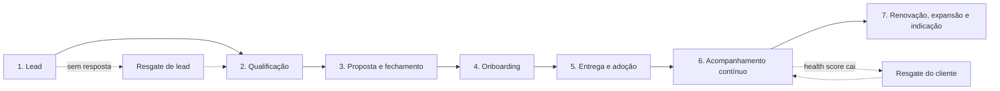

# Playbook de Customer Success e Onboarding

🇧🇷 Português · [🇺🇸 English](README.en.md)

Guia prático para **acompanhar o cliente da primeira conversa até a operação contínua**: jornada, onboarding, health score, scripts de follow-up e de resgate. Foi montado a partir de conceitos de Customer Success e da rotina real de atendimento de leads, acompanhamento de projetos e pós-venda.

> **Aviso:** o conteúdo é genérico. Nomes, prazos, pesos e mensagens são **modelos de exemplo** para adaptar. Nenhuma informação de empresa ou cliente real foi publicada.

## Sumário

1. [Objetivo](#objetivo)
2. [Jornada do cliente](#jornada-do-cliente)
3. [Onboarding passo a passo](#onboarding-passo-a-passo)
4. [Modelo de health score](#modelo-de-health-score)
5. [Scripts de follow-up (PT e EN)](#scripts-de-follow-up)
6. [Scripts de resgate de lead (PT e EN)](#scripts-de-resgate-de-lead)
7. [Resgate de cliente em risco](#resgate-de-cliente-em-risco)
8. [Indicadores para acompanhar](#indicadores-para-acompanhar)
9. [Como adaptar](#como-adaptar)

## Objetivo

- Dar **previsibilidade** ao relacionamento: cada etapa tem responsável, prazo e próxima ação.
- Detectar **cedo** quando um cliente esfria, antes de virar cancelamento.
- Padronizar a comunicação sem perder o tom **humano**.

## Jornada do cliente



| Etapa | Objetivo | Ação principal | Responsável |
|---|---|---|---|
| 1. Lead | Responder rápido e entender a necessidade | Primeiro contato em até 1 hora útil (meta de exemplo) | Atendimento |
| 2. Qualificação | Confirmar necessidade, prazo e orçamento | Perguntas de descoberta | Atendimento |
| 3. Proposta e fechamento | Formalizar o combinado | Proposta clara, com escopo e prazos | Comercial |
| 4. Onboarding | Alinhar expectativas e planejar | Kick-off e plano de ação | CS |
| 5. Entrega e adoção | Executar com qualidade | Cronograma, acompanhamento e validação | CS e Operações |
| 6. Acompanhamento contínuo | Manter o cliente saudável | Check-ins e health score | CS |
| 7. Renovação, expansão e indicação | Gerar novos resultados | Pesquisa de satisfação e pedido de indicação | CS |

## Onboarding passo a passo

Os prazos abaixo (D0, D+1...) são **premissas de exemplo**. Ajuste ao ciclo do seu serviço.

| Passo | Quando | O que fazer | Entregável |
|---|---|---|---|
| 1. Boas-vindas | D0 | Mensagem de boas-vindas e apresentação do ponto de contato | Mensagem enviada |
| 2. Kick-off | D0 a D+2 | Conversa para alinhar objetivos, expectativas e rotina de comunicação | Objetivos registrados |
| 3. Plano de ação | D+2 a D+3 | Montar cronograma, responsáveis e recursos necessários | Plano de ação aprovado |
| 4. Execução | Conforme o plano | Acompanhar etapas e avisar sobre qualquer mudança | Atualizações no combinado |
| 5. Entrega e validação | Fim da execução | Confirmar com o cliente que o resultado foi o esperado | Aceite do cliente |
| 6. Check-in pós-entrega | D+7 após a entrega | Perguntar como está e resolver pendências | Pendências resolvidas |
| 7. Pesquisa e transição | D+30 após a entrega | Pesquisa de satisfação e passagem para o acompanhamento contínuo | Nota de satisfação |

### Modelo de plano de ação

| Etapa | Responsável | Prazo | Recursos | Status |
|---|---|---|---|---|
| Kick-off | CS | [data] | Agenda do cliente | A fazer |
| Preparação | Operações | [data] | [materiais] | A fazer |
| Execução | Operações | [data] | [equipe] | A fazer |
| Validação | CS | [data] | Checklist de entrega | A fazer |

### Checklist de onboarding

- [ ] Ponto de contato definido e apresentado ao cliente
- [ ] Objetivos e expectativas registrados
- [ ] Plano de ação enviado e aprovado
- [ ] Canal e frequência de comunicação combinados
- [ ] Riscos e dependências identificados
- [ ] Entrega validada pelo cliente
- [ ] Check-in pós-entrega agendado

## Modelo de health score

O health score resume, em um número de 0 a 100, **como está a saúde da relação** com cada cliente. Cada critério recebe uma nota de 0 a 100, multiplicada pelo seu peso.

| Critério | Peso | Como medir (exemplo) |
|---|---|---|
| Adoção e uso | 30% | O cliente usa o que contratou ou segue o plano? |
| Engajamento | 20% | Responde mensagens e comparece às reuniões? |
| Satisfação | 20% | Nota de NPS ou CSAT mais recente |
| Suporte | 15% | Quantidade e gravidade de problemas em aberto |
| Financeiro | 10% | Pagamentos em dia |
| Relacionamento | 5% | Contato recente com a pessoa que decide |

> Os pesos são uma **premissa de exemplo**. Soma: 30 + 20 + 20 + 15 + 10 + 5 = 100.

**Faixas**

| Pontuação | Situação | Ação |
|---|---|---|
| 80 a 100 | 🟢 Saudável | Manter o ritmo e pedir indicação |
| 50 a 79 | 🟡 Atenção | Check-in extra e plano para melhorar o critério mais fraco |
| 0 a 49 | 🔴 Risco | Contato imediato e plano de resgate |

**Exemplo de cálculo (fictício)**

| Critério | Nota | Peso | Pontos |
|---|---|---|---|
| Adoção e uso | 80 | 30% | 24,0 |
| Engajamento | 70 | 20% | 14,0 |
| Satisfação | 90 | 20% | 18,0 |
| Suporte | 60 | 15% | 9,0 |
| Financeiro | 100 | 10% | 10,0 |
| Relacionamento | 50 | 5% | 2,5 |
| **Total** | | | **77,5** → 🟡 Atenção |

Neste exemplo, o ponto mais fraco é o relacionamento. A ação seria agendar uma conversa com quem decide.

## Scripts de follow-up

Use os colchetes `[ ]` para personalizar. Mensagens curtas, uma ideia por mensagem e sempre com uma próxima ação clara.

### 1. Boas-vindas

**PT:**
> Olá, [Nome]! Seja bem-vindo(a)! Eu sou a [Seu nome] e vou acompanhar o seu projeto de perto. Posso te chamar amanhã às [horário] para alinharmos os próximos passos?

**EN:**
> Hi [Name]! Welcome aboard! I'm [Your name] and I'll be following your project closely. Can I call you tomorrow at [time] to align on the next steps?

### 2. Follow-up depois da proposta (dia seguinte)

**PT:**
> Oi, [Nome]! Tudo bem? Passando para saber se você conseguiu ver a proposta. Ficou alguma dúvida que eu possa esclarecer?

**EN:**
> Hi [Name]! Hope you're well. I just wanted to check if you had a chance to look at the proposal. Is there anything I can clarify?

### 3. Follow-up depois da proposta (3 dias)

**PT:**
> [Nome], só reforçando que a nossa agenda para [mês] está fechando. Se fizer sentido para você, posso reservar um horário. Qual o melhor dia?

**EN:**
> [Name], just a quick note that our schedule for [month] is filling up. If it makes sense for you, I can reserve a spot. What day works best?

### 4. Atualização durante a execução

**PT:**
> Oi, [Nome]! Atualização do seu projeto: [etapa concluída]. Próximo passo: [próxima etapa], previsto para [data]. Se algo mudar, aviso você na hora.

**EN:**
> Hi [Name]! Project update: [completed step]. Next step: [next step], expected on [date]. If anything changes, I'll let you know right away.

### 5. Check-in pós-entrega (D+7)

**PT:**
> Oi, [Nome]! Já faz uma semana desde a entrega. Como está tudo por aí? Se tiver qualquer ponto para ajustar, me conta que eu resolvo.

**EN:**
> Hi [Name]! It's been a week since the delivery. How is everything going? If there's anything to adjust, just let me know and I'll take care of it.

### 6. Pesquisa de satisfação e indicação (D+30)

**PT:**
> [Nome], de 0 a 10, qual a chance de você nos recomendar a um amigo ou colega? E se puder, me conta o motivo da nota. Sua opinião ajuda a melhorar o nosso trabalho.

**EN:**
> [Name], on a scale of 0 to 10, how likely are you to recommend us to a friend or colleague? And if you can, tell me the reason for your score. Your feedback helps us improve.

## Scripts de resgate de lead

Para leads que **pararam de responder**. A sequência é escalonada, cada mensagem traz um motivo novo para voltar a conversar, e a última encerra com educação.

| Mensagem | Quando | Estratégia |
|---|---|---|
| 1 | 2 a 3 dias sem resposta | Lembrete leve e pergunta fácil |
| 2 | 5 a 7 dias | Oferecer ajuda ou conteúdo útil |
| 3 | 10 a 14 dias | Facilitar a decisão |
| 4 | 20 dias | Mensagem de encerramento |

**Mensagem 1 – lembrete leve**

**PT:**
> Oi, [Nome]! Tudo bem? Fiquei pensando no seu projeto. Ainda faz sentido conversarmos sobre isso?

**EN:**
> Hi [Name]! Hope you're doing well. I was thinking about your project. Does it still make sense to talk about it?

**Mensagem 2 – ajuda**

**PT:**
> [Nome], sei que a rotina é corrida. Se ficou alguma dúvida sobre [prazo, valor ou escopo], me conta que eu esclareço. Posso também te mandar um exemplo de como foi um projeto parecido.

**EN:**
> [Name], I know things get busy. If you have any questions about [timeline, price or scope], let me know and I'll clarify. I can also send you an example of a similar project.

**Mensagem 3 – facilitar a decisão**

**PT:**
> Oi, [Nome]! Se ajudar, posso ajustar a proposta ao que for mais importante para você agora. Quer que eu monte uma opção mais simples?

**EN:**
> Hi [Name]! If it helps, I can adjust the proposal to what matters most to you right now. Would you like me to put together a simpler option?

**Mensagem 4 – encerramento educado**

**PT:**
> [Nome], não quero ser inconveniente, então vou encerrar o seu atendimento por aqui. Se o assunto voltar a ser prioridade, é só me chamar, vou ficar feliz em ajudar. Desejo muito sucesso!

**EN:**
> [Name], I don't want to be a bother, so I'll close your request for now. If this becomes a priority again, just reach out. I'll be happy to help. Wishing you all the best!

## Resgate de cliente em risco

Quando o health score cai para a faixa 🟡 ou 🔴:

1. **Identifique o critério mais fraco** do score.
2. **Contate pessoalmente** (ligação ou mensagem direta), sem esperar a próxima rotina.
3. **Escute primeiro:** pergunte o que mudou e o que ficou abaixo do esperado.
4. **Proponha um plano curto** com uma ação, um responsável e um prazo.
5. **Acompanhe** em 7 dias e recalcule o score.

**PT:**
> Oi, [Nome]! Percebi que [situação observada] e quero entender melhor como estamos te atendendo. Podemos conversar 15 minutos esta semana? Quero ouvir você e combinar o que fazer para melhorar.

**EN:**
> Hi [Name]! I noticed [observed situation] and I'd like to understand how we're serving you. Can we talk for 15 minutes this week? I want to listen and agree on what we can do to improve.

## Indicadores para acompanhar

| Indicador | O que mostra |
|---|---|
| Tempo até a primeira resposta | Agilidade no atendimento |
| Taxa de resposta aos follow-ups | Eficácia das mensagens |
| Leads resgatados | Resultado da sequência de resgate |
| Tempo de onboarding | Eficiência do início da relação |
| NPS e CSAT | Satisfação do cliente |
| Clientes por faixa de health score | Saúde geral da carteira |
| Taxa de cancelamento (churn) | Retenção |

## Como adaptar

1. Troque os **prazos** e **pesos do health score** pela realidade do seu serviço.
2. Ajuste o **tom** das mensagens ao seu público e ao canal (WhatsApp, e-mail, ligação).
3. Registre os resultados dos follow-ups e **revise as mensagens** que menos funcionam.
4. Comece com poucos clientes, valide o score e depois aplique em toda a carteira.

## Estrutura do repositório

```
customer-success-playbook/
├── README.md        (português)
└── README.en.md     (English)
```

## Autora

**Laiana Paganelli** · Processos, Operações e Customer Success
[LinkedIn](https://www.linkedin.com/in/laianapaganelli/)
