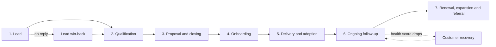

# Customer Success and Onboarding Playbook

[🇧🇷 Português](README.md) · 🇺🇸 English

A practical guide to **following a customer from the first conversation to ongoing operations**: journey, onboarding, health score, follow-up scripts and win-back scripts. It was built from Customer Success concepts and from real day-to-day work with lead handling, project follow-up and after-sales.

> **Note:** the content is generic. Names, timelines, weights and messages are **sample templates** to adapt. No real company or customer information has been published.

## Contents

1. [Goal](#goal)
2. [Customer journey](#customer-journey)
3. [Step-by-step onboarding](#step-by-step-onboarding)
4. [Health score model](#health-score-model)
5. [Follow-up scripts](#follow-up-scripts)
6. [Lead win-back scripts](#lead-win-back-scripts)
7. [At-risk customer recovery](#at-risk-customer-recovery)
8. [Metrics to track](#metrics-to-track)
9. [How to adapt](#how-to-adapt)

## Goal

- Bring **predictability** to the relationship: every stage has an owner, a deadline and a next action.
- Spot **early** when a customer is cooling off, before it turns into churn.
- Standardize communication without losing a **human** tone.

## Customer journey



| Stage | Goal | Main action | Owner |
|---|---|---|---|
| 1. Lead | Reply fast and understand the need | First contact within 1 business hour (sample target) | Customer service |
| 2. Qualification | Confirm need, timeline and budget | Discovery questions | Customer service |
| 3. Proposal and closing | Formalize the agreement | Clear proposal with scope and deadlines | Sales |
| 4. Onboarding | Align expectations and plan | Kick-off and action plan | CS |
| 5. Delivery and adoption | Execute with quality | Schedule, follow-up and validation | CS and Operations |
| 6. Ongoing follow-up | Keep the customer healthy | Check-ins and health score | CS |
| 7. Renewal, expansion and referral | Generate new results | Satisfaction survey and referral request | CS |

## Step-by-step onboarding

The timelines below (D0, D+1...) are **sample assumptions**. Adjust them to your service cycle.

| Step | When | What to do | Deliverable |
|---|---|---|---|
| 1. Welcome | D0 | Welcome message and introduction of the point of contact | Message sent |
| 2. Kick-off | D0 to D+2 | Conversation to align goals, expectations and communication routine | Goals recorded |
| 3. Action plan | D+2 to D+3 | Build the schedule, owners and required resources | Approved action plan |
| 4. Execution | As per plan | Track stages and flag any change | Updates shared |
| 5. Delivery and validation | End of execution | Confirm with the customer that the result is as expected | Customer sign-off |
| 6. Post-delivery check-in | D+7 after delivery | Ask how things are going and solve open issues | Issues resolved |
| 7. Survey and handover | D+30 after delivery | Satisfaction survey and move to ongoing follow-up | Satisfaction score |

### Action plan template

| Stage | Owner | Deadline | Resources | Status |
|---|---|---|---|---|
| Kick-off | CS | [date] | Customer's calendar | To do |
| Preparation | Operations | [date] | [materials] | To do |
| Execution | Operations | [date] | [team] | To do |
| Validation | CS | [date] | Delivery checklist | To do |

### Onboarding checklist

- [ ] Point of contact defined and introduced to the customer
- [ ] Goals and expectations recorded
- [ ] Action plan sent and approved
- [ ] Communication channel and frequency agreed
- [ ] Risks and dependencies identified
- [ ] Delivery validated by the customer
- [ ] Post-delivery check-in scheduled

## Health score model

The health score summarizes, in a number from 0 to 100, **how healthy the relationship is** with each customer. Each criterion gets a score from 0 to 100, multiplied by its weight.

| Criterion | Weight | How to measure (example) |
|---|---|---|
| Adoption and usage | 30% | Is the customer using what they bought or following the plan? |
| Engagement | 20% | Do they answer messages and attend meetings? |
| Satisfaction | 20% | Most recent NPS or CSAT score |
| Support | 15% | Number and severity of open issues |
| Financial | 10% | Payments on time |
| Relationship | 5% | Recent contact with the decision-maker |

> Weights are a **sample assumption**. Total: 30 + 20 + 20 + 15 + 10 + 5 = 100.

**Bands**

| Score | Status | Action |
|---|---|---|
| 80 to 100 | 🟢 Healthy | Keep the pace and ask for a referral |
| 50 to 79 | 🟡 Attention | Extra check-in and a plan to improve the weakest criterion |
| 0 to 49 | 🔴 At risk | Immediate contact and a recovery plan |

**Calculation example (fictional)**

| Criterion | Score | Weight | Points |
|---|---|---|---|
| Adoption and usage | 80 | 30% | 24.0 |
| Engagement | 70 | 20% | 14.0 |
| Satisfaction | 90 | 20% | 18.0 |
| Support | 60 | 15% | 9.0 |
| Financial | 100 | 10% | 10.0 |
| Relationship | 50 | 5% | 2.5 |
| **Total** | | | **77.5** → 🟡 Attention |

In this example the weakest point is the relationship. The action would be to schedule a conversation with the decision-maker.

## Follow-up scripts

Use the brackets `[ ]` to personalize. Keep messages short, one idea per message, always with a clear next action.

### 1. Welcome

> Hi [Name]! Welcome aboard! I'm [Your name] and I'll be following your project closely. Can I call you tomorrow at [time] to align on the next steps?

### 2. Follow-up after the proposal (next day)

> Hi [Name]! Hope you're well. I just wanted to check if you had a chance to look at the proposal. Is there anything I can clarify?

### 3. Follow-up after the proposal (3 days)

> [Name], just a quick note that our schedule for [month] is filling up. If it makes sense for you, I can reserve a spot. What day works best?

### 4. Update during execution

> Hi [Name]! Project update: [completed step]. Next step: [next step], expected on [date]. If anything changes, I'll let you know right away.

### 5. Post-delivery check-in (D+7)

> Hi [Name]! It's been a week since the delivery. How is everything going? If there's anything to adjust, just let me know and I'll take care of it.

### 6. Satisfaction survey and referral (D+30)

> [Name], on a scale of 0 to 10, how likely are you to recommend us to a friend or colleague? And if you can, tell me the reason for your score. Your feedback helps us improve.

## Lead win-back scripts

For leads that **stopped replying**. The sequence is staged: each message gives a new reason to talk again, and the last one closes politely.

| Message | When | Strategy |
|---|---|---|
| 1 | 2 to 3 days without reply | Light reminder and an easy question |
| 2 | 5 to 7 days | Offer help or useful content |
| 3 | 10 to 14 days | Make the decision easier |
| 4 | 20 days | Closing message |

**Message 1 – light reminder**

> Hi [Name]! Hope you're doing well. I was thinking about your project. Does it still make sense to talk about it?

**Message 2 – offer help**

> [Name], I know things get busy. If you have any questions about [timeline, price or scope], let me know and I'll clarify. I can also send you an example of a similar project.

**Message 3 – make the decision easier**

> Hi [Name]! If it helps, I can adjust the proposal to what matters most to you right now. Would you like me to put together a simpler option?

**Message 4 – polite close**

> [Name], I don't want to be a bother, so I'll close your request for now. If this becomes a priority again, just reach out. I'll be happy to help. Wishing you all the best!

## At-risk customer recovery

When the health score falls into the 🟡 or 🔴 band:

1. **Identify the weakest criterion** in the score.
2. **Reach out personally** (call or direct message), without waiting for the next routine check-in.
3. **Listen first:** ask what changed and what fell short.
4. **Propose a short plan** with one action, one owner and one deadline.
5. **Follow up** in 7 days and recalculate the score.

> Hi [Name]! I noticed [observed situation] and I'd like to understand how we're serving you. Can we talk for 15 minutes this week? I want to listen and agree on what we can do to improve.

## Metrics to track

| Metric | What it shows |
|---|---|
| Time to first response | Service speed |
| Follow-up response rate | Message effectiveness |
| Leads won back | Result of the win-back sequence |
| Onboarding time | Efficiency at the start of the relationship |
| NPS and CSAT | Customer satisfaction |
| Customers by health score band | Overall portfolio health |
| Churn rate | Retention |

## How to adapt

1. Replace the **timelines** and **health score weights** with your service's reality.
2. Adjust the **tone** of the messages to your audience and channel (WhatsApp, email, phone).
3. Record follow-up results and **review the messages** that work least.
4. Start with a few customers, validate the score, then apply it to the whole portfolio.

## Repository structure

```
customer-success-playbook/
├── README.md        (Português)
└── README.en.md     (English)
```

## Author

**Laiana Paganelli** · Processes, Operations and Customer Success
[LinkedIn](https://www.linkedin.com/in/laianapaganelli/)
